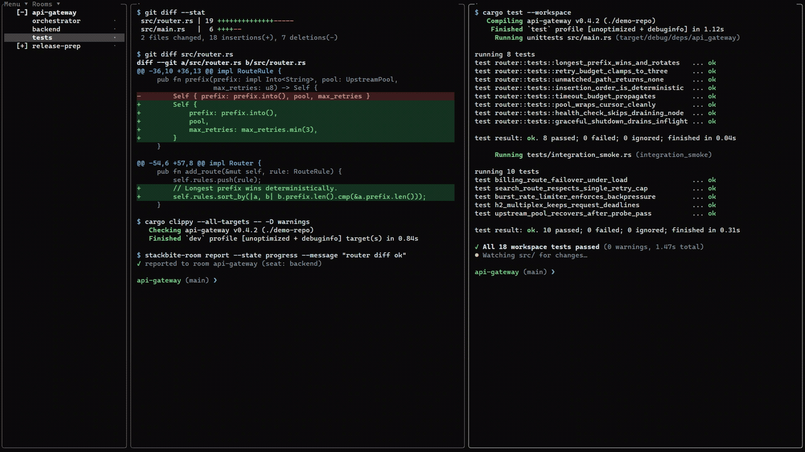

# StackBite

[](https://www.npmjs.com/package/stackbite)
[](https://github.com/BiteFoundry/stackbite/releases/tag/v0.8.0)
[](https://bitefoundry.dev/stackbite)
[](https://bitefoundry.dev/stackbite)



> **Rooms & Split Panes · Files Preview · Menu & Ctrl+B Help** — captured directly from the native StackBite v0.8.0 runtime · [bitefoundry.dev/stackbite](https://bitefoundry.dev/stackbite) · [한국어 README](README.ko.md)
A terminal workspace for shells and AI coding agents, organized into Rooms and
Seats. The app is a Rust-native launcher, Room service, terminal owner and TUI;
no Python is needed to run it.

Current release: **0.8.0** · [Release notes](https://github.com/BiteFoundry/stackbite/releases/tag/v0.8.0) · [All releases](https://github.com/BiteFoundry/stackbite/releases) · [Issues](https://github.com/BiteFoundry/stackbite/issues)

## Install

Install the current [Node.js LTS](https://nodejs.org/en/download) (Node.js 20 or
later), open a new terminal and run:

```sh
npm install --global stackbite@latest
stackbite setup
stackbite
```

The npm package is a small launcher. `setup` downloads and verifies its pinned
native bundle without opening the app; the first launch also prepares it if
needed, and later launches reuse the verified copy. `npx --yes stackbite@latest`
runs it once. Install and sign in to your provider CLIs separately.

Without Node.js, download a native bundle from the
[latest release](https://github.com/BiteFoundry/stackbite/releases/latest),
extract the **entire** archive and run `stackbite.exe` (Windows) or `./stackbite`
(Linux, macOS).

| Platform | 0.8.0 bundle |
| --- | --- |
| Windows | x64 |
| Linux | x86_64, GLIBC 2.28+ |
| macOS | Apple Silicon and Intel, macOS 13+ |

Linux ARM and musl/Alpine bundles are not provided. npm details:
[packaging/npm/README.md](https://github.com/BiteFoundry/stackbite/blob/main/packaging/npm/README.md).

## Use

Start `stackbite` in a project directory. The sidebar switches between **Rooms**
(Rooms and Seats) and **Files** (bounded read-only Preview). **Menu** opens
actions and settings. Closing the window leaves native-owned work running; Room
and Seat definitions and saved records persist, and conversation resume depends
on the provider.

Press `Ctrl+B`, release it, then `?` for Help. `w` opens a new Room, `c` a new
Seat, `f` focuses the list and `q` closes the window while keeping Seats running.
Change keys in **Settings → Keyboard shortcuts**.

## Remote execution hosts

In **Menu → Connections**, **Setup** and **Test** prepare a small, verified runtime
capsule on a Linux x86_64 (GLIBC 2.28+) SSH host, so it runs remote Seats without
a full StackBite installation. Choose the host with **Run on**. Remote status is
batched over existing connections, unused capsule files are pruned in bounded idle
passes, and **Forget** of an unreachable host keeps its credential removal pending
until the host is reachable. Authentication is native OpenSSH; StackBite stores no
passwords. Windows execution hosts cannot run the capsule.

## Update and maintenance

```sh
stackbite --version
stackbite --status
stackbite update --check
stackbite update
stackbite restart
stackbite stop --preview
stackbite uninstall --preview
```

Update npm installations with `npm install --global stackbite@latest`. Installing
and activating an update are separate steps; running CLIs stay on their engine
until an explicit Stop and Resume. `restart` recovers the local Room service and
keeps definitions and records. `stackbite --help`, `stackbite remote --help` and
`stackbite agent --help` describe all commands.

## Distribution and license

This repository distributes the npm launcher, installers and signed native release
artifacts. The first-party source is private. StackBite 0.5.122 and later is
licensed under the
[StackBite License](https://github.com/BiteFoundry/stackbite/blob/main/LICENSE);
releases 0.5.121 and earlier keep their MIT License. Bundled dependencies retain
their own licenses and notices. Each release's notes state its actual platform
validation and known limits.
